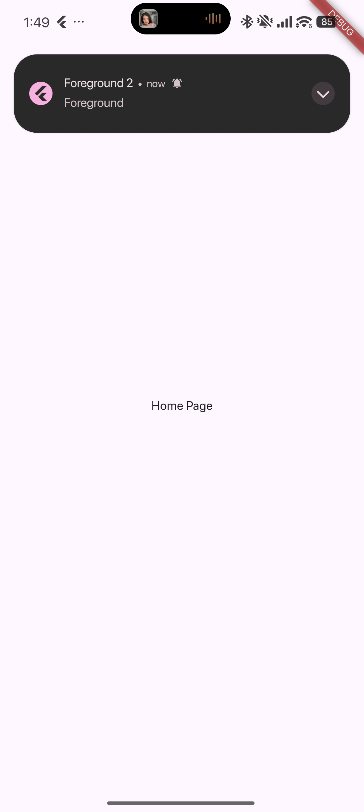
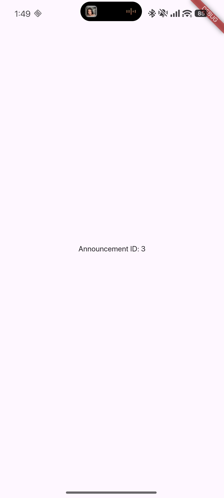
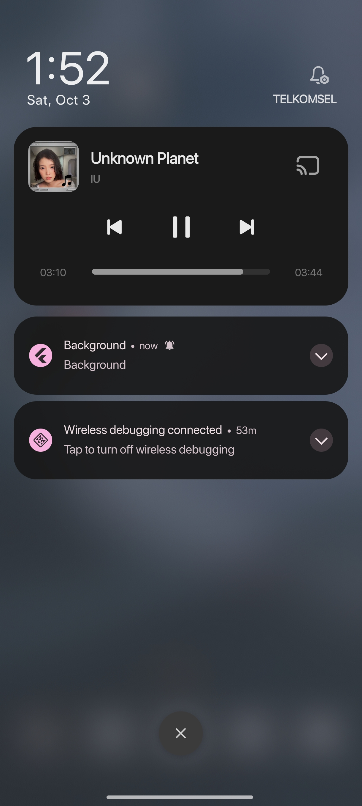
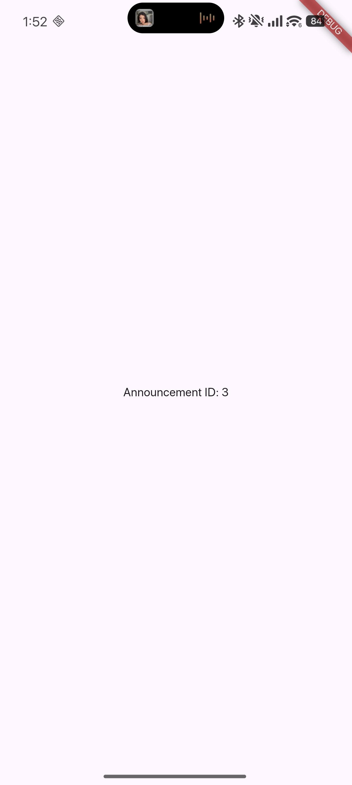
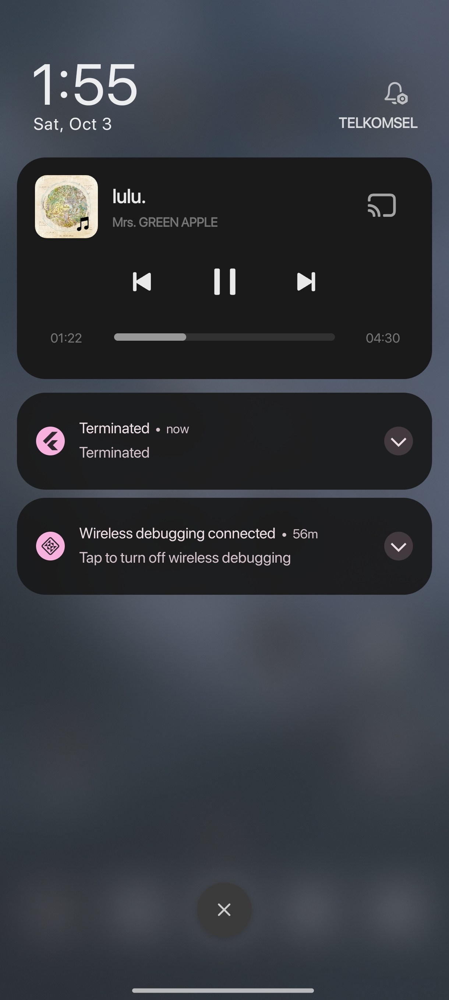
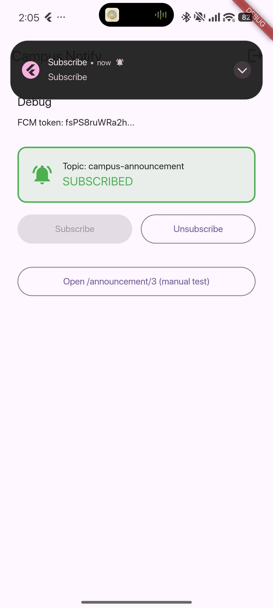
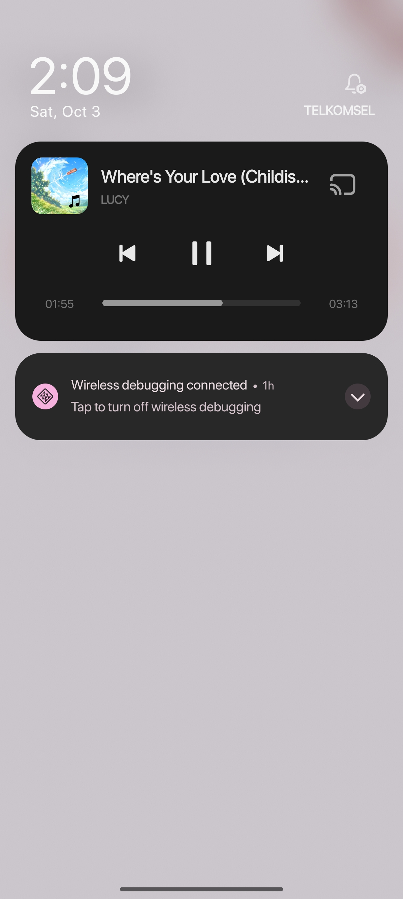
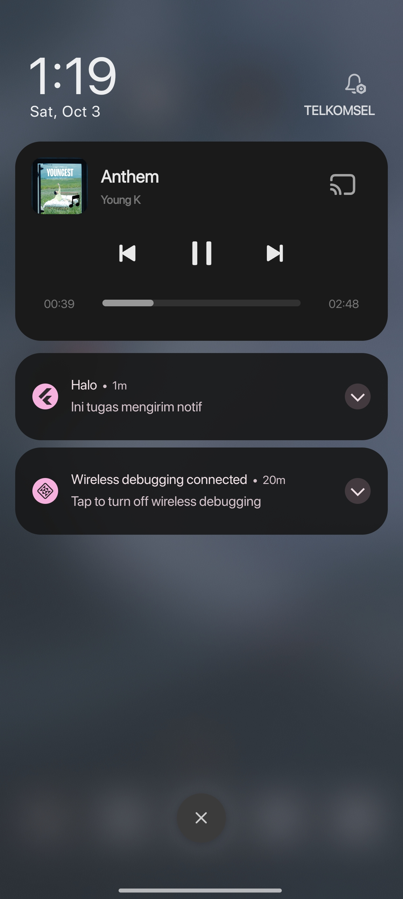

# Campus Notify — Week 6: Authentication, Security & FCM

A secure Flutter mobile application demonstrating token-based authentication lifecycle, encrypted local storage, centralized routing, and Firebase Cloud Messaging (FCM) push notifications across all three app lifecycle states (foreground, background, and terminated).

---

## Table of Contents

- [Overview & Objectives](#overview--objectives)
- [Tech Stack](#tech-stack)
- [Key Features & Architecture](#key-features--architecture)
  - [1. Authentication & Route Guard](#1-authentication--route-guard)
  - [2. Secure Token Storage & Auto-Refresh Interceptor](#2-secure-token-storage--auto-refresh-interceptor)
  - [3. FCM Token Lifecycle & Backend Sync](#3-fcm-token-lifecycle--backend-sync)
  - [4. Topic Subscription](#4-topic-subscription)
  - [5. Centralized Routing & Pure Message Parsing](#5-centralized-routing--pure-message-parsing)
  - [6. API Error Handling](#6-api-error-handling)
- [Running & Testing](#running--testing)
- [Three-State Notification Test Table](#three-state-notification-test-table)
- [Screenshot Evidence](#screenshot-evidence)
- [Reflection](#reflection)

---

## Overview & Objectives

In mobile client engineering, handling authentication securely and delivering reliable push notifications are mission-critical. This project addresses the most common and critical production vulnerabilities:
- Storing long-lived refresh tokens in unencrypted plain text.
- Silent push notification failure due to unhandled `onTokenRefresh` events.
- Inconsistent routing upon tapping notifications across different app lifecycle states.
- Exposing raw network/server exceptions directly to end users.

### Mid-semester readiness (October 29, 2026)

The project is in feature-first structure, with presentation, domain, and data responsibilities separated. The Week 7 boundary searches found no infrastructure imports in presentation pages, no Flutter or infrastructure imports in domain, and no repository implementation construction in presentation pages.

| Check | Result |
|---|---|
| `flutter analyze` | Pass — no issues found |
| `dart format --set-exit-if-changed .` | Pass — 32 files checked, 0 changed |
| `flutter test` | Pass — all 14 tests passed |
| PR automation | Added in [`../../../.github/workflows/ci.yml`](../../../.github/workflows/ci.yml); will run on the next PR update |

Issue and PR map:

| Issue | Pull request | Status |
|---|---|---|
| [#12 — reject blank note titles](https://github.com/emrizky1/244107020140-mobile-course/issues/12) | [#1 — validate blank note titles and add a test](https://github.com/emrizky1/244107020140-mobile-course/pull/1) | Open; not merged |

Peer feedback recommends adding widget coverage for whitespace-only and valid titles. That feedback is still pending, and this PR has not yet completed the review and merge step. Current screenshots and the run guide are listed below; before-refactor screenshot evidence is unavailable.

---

## Tech Stack

| Layer | Technology |
|---|---|
| **Framework** | Flutter (Dart SDK ^3.13.2) |
| **State Management** | `flutter_riverpod` (^3.4.3) with `AsyncNotifier` |
| **Navigation & Routing** | `go_router` (^18.0.2) with declarative route guards |
| **HTTP Client** | `dio` (^5.11.1) with custom interceptors for token auto-refresh |
| **Encrypted Storage** | `flutter_secure_storage` (^11.2.0) (Keystore on Android, Keychain on iOS) |
| **Push Notifications** | `firebase_core` (^4.15.0), `firebase_messaging` (^16.7.0) |
| **Local Notifications** | `flutter_local_notifications` (^22.3.1) |
| **Testing** | `flutter_test` (unit & widget tests) |

---

## Key Features & Architecture

### Clean Architecture Lab — project audit

The project is organized by feature. Dependencies point inward: presentation calls domain contracts and use cases where they hold meaningful business rules, while data provides their implementations.

| File / responsibility | Layer | Audit finding and change |
|---|---|---|
| `features/notifications/presentation/pages/home_page.dart` | Presentation | Previously accessed Firebase Messaging and secure storage via helper functions. It now depends on `NotificationRepository`; no network or storage API is used by the widget. |
| `features/notifications/presentation/providers/notifications_providers.dart` | Presentation / DI | Sole Riverpod wiring point for the notification repository contract and implementation. |
| `features/notifications/data/services/push_service.dart` | Data / integration | Owns FCM, local-notification, and device-registration integrations. It uses pure route parsing from `core/format.dart`. |
| `features/auth/presentation/providers/auth_provider.dart` | Presentation / state | Riverpod state and composition providers. Login uses the domain `Login` use case. |
| `features/auth/domain/repositories/auth_repository.dart` | Domain contract | Auth contract lives separately from its implementation. |
| `features/auth/data/repositories/auth_repository_impl.dart` | Data implementation | Implements the domain contract; currently returns mock sessions and refresh tokens. |
| `features/auth/data/api_client.dart` | Data / integration | Builds Dio with token and refresh handling. It is kept outside presentation. |
| `core/api_errors.dart` | Core | Shared API error mapping. |

Classic violation audit:

- **Widgets touching network/storage:** removed from the presentation folders. Firebase and secure-storage calls are behind notification/auth data services and repositories.
- **Business logic in widgets:** no date formatting or JSON parsing is done in widgets. `formatDateTime` and `routeFromMessage` are pure functions in `core/format.dart`.
- **Manual repository construction in widgets:** widgets get repository contracts through Riverpod. Implementations are constructed in feature provider composition; startup push registration reads the already-wired Dio client provider.

Target structure now used by the app:

```text
lib/
├── core/                         # shared failures and infrastructure
├── features/
│   ├── auth/
│   │   ├── domain/               # session entity, repository contract, Login use case
│   │   ├── data/                 # repository implementation, token storage, Dio client
│   │   └── presentation/         # Riverpod state and login page
│   └── notifications/
│       ├── domain/               # notification repository contract
│       ├── data/                 # FCM/local notifications and repository implementation
│       └── presentation/         # home and announcement pages
├── routing/                      # route constants and GoRouter composition
└── main.dart                     # application composition root
```

### Lab 2 — Notes domain and local data

The `notes` feature demonstrates the domain/data split with a small SQLite-backed workflow:

- `features/notes/domain/entities/note.dart` is a pure Dart entity with no Flutter or persistence imports.
- `features/notes/domain/repositories/note_repository.dart` defines `fetchNotes` and `addNote`, returning Dart records with explicit `Failure?` values.
- `core/failures.dart` defines local and network failure types.
- `features/notes/data/models/note_model.dart` owns map conversion, timestamp serialization, and entity conversion.
- `features/notes/data/repositories/note_repository_impl.dart` implements the contract using SQLite and translates database exceptions into `LocalFailure`.
- `features/notes/presentation/providers/notes_providers.dart` wires the repository into the Notes state notifier. Notes is local CRUD, so the notifier calls the repository directly instead of adding one-line use cases.
- `features/notes/presentation/pages/notes_page.dart` lists and creates local notes without calling SQLite directly.

Open **Notes** from the home screen to add and view saved notes. The local SQLite adapter uses `sqflite`, which targets Android, iOS, and macOS.

### Lab 3 — Presentation, dependency injection, and verification

- `features/notes/presentation/providers/notes_providers.dart` is the Notes wiring point: it provides the repository implementation and UI state notifier. The database opener is injected into `NoteRepositoryImpl`.
- `features/notes/presentation/pages/notes_page.dart` reads `NotesState` and sends user actions to the notifier. It contains no SQL, Dio, JSON parsing, or direct storage calls; failures remain explicit and can be retried.
- Presentation raw-data search: **zero hits** for Dio, database opening, secure storage, shared preferences, or direct Firebase calls.
- Domain framework/package search: **zero hits** for Flutter, Dio, sqflite, Firebase, or secure-storage imports.
- `flutter analyze`: **No issues found**.
- `flutter test`: **All tests passed** (14 total, including route/date formatting, API/auth failure mapping, Notes state, and widget tests).

Before-refactor screenshots were not captured. Current screenshots are stored in `screenshots/after-notes.jpg`, `screenshots/after-announcements.jpg`, and `screenshots/after-auth.jpg`.

### Lab 4 — Refactoring and common errors

- Auth also follows entity → domain repository contract → data implementation → Riverpod provider wiring. `Login` owns email/password validation; Notes stays direct repository-to-notifier because its current operations are simple local CRUD.
- `lib/core/format.dart` contains pure `routeFromMessage` and `formatDateTime` functions. FCM routing and the Notes date label use these functions without adding a formatting package.
- Repository and notifier boundaries turn raw storage, Firebase, auth, and Dio errors into typed `Failure` values with user-friendly messages. Pages render only `Failure.message` or a safe fallback.
- `flutter analyze`: **No issues found**; `flutter test`: **All 14 tests passed**.

### 1. Authentication & Route Guard
- Managed by `authStateProvider` (`AsyncNotifier<bool>`).
- `routerProvider` listens to `authStateProvider` and enforces authentication:
  - Unauthenticated users attempting to access protected routes are automatically redirected to `/login`.
  - Authenticated users attempting to visit `/login` are automatically redirected to `/`.

### 2. Secure Token Storage & Auto-Refresh Interceptor
- Tokens are stored in hardware-backed secure storage via `TokenStore`:
  - `access_token`: Short-lived token attached to HTTP requests via `Authorization: Bearer <token>`.
  - `refresh_token`: Long-lived token used to renew access tokens.
- `Dio` interceptor in `lib/features/auth/data/api_client.dart`:
  - Automatically captures HTTP `401 Unauthorized` responses.
  - Automatically attempts token renewal via `AuthRepository.refresh()`.
  - Updates `TokenStore` with the renewed access token and retries the original request once.
  - If the refresh token is expired or invalid, clears all tokens (`TokenStore.clear()`) and triggers a force logout.

### 3. FCM Token Lifecycle & Backend Sync
- On launch, the app requests notification permissions (`requestNotificationPermission()`).
- The device token is retrieved via `FirebaseMessaging.instance.getToken()`.
- Both the initial token and any rotated tokens emitted by `FirebaseMessaging.instance.onTokenRefresh` are sent to the backend via `sendTokenToBackend(dio, token)` targeting `POST /devices`.
- Token logging is safely truncated (e.g., `token.substring(0, 12)...`) to avoid leaking full credentials in logcat/console.

### 4. Topic Subscription
- Supports broad campus announcements via the `campus-announcement` topic.
- Preference state is persisted in encrypted storage (`FlutterSecureStorage`).
- Dedicated UI allows subscribing and unsubscribing with live visual status feedback.

### 5. Centralized Routing & Pure Message Parsing
- All routes (`Routes.home`, `Routes.login`, `Routes.announcementById`, etc.) are centralized in `lib/routing/routes.dart`.
- Route parsing and date formatting live in pure, testable helpers in `lib/core/format.dart`:
  ```dart
  String routeFromMessage(Map<String, dynamic> data, {String fallbackRoute = '/'})
  String formatDateTime(DateTime dateTime)
  ```
  This allows 100% offline unit testing without initializing Firebase.

### 6. API Error Handling
- Network exceptions are mapped to typed failures in `lib/core/api_errors.dart` via `mapApiError(Object error)`.
- Translates connection timeouts, certificate errors, offline status, and HTTP status codes (400, 401, 403, 404, 409, 429, 500+) into friendly user messages.

---

## Running & Testing

### Run App
```bash
flutter pub get
flutter run
```

### Run Tests
```bash
flutter test
```
All 14 unit and widget tests pass, covering route/date formatting, API/auth failure mapping, Notes state/repository behavior, and UI rendering.

### Static Analysis
```bash
flutter analyze
```
Result:
```
Analyzing campus_notify...
No issues found!
```

---

## Three-State Notification Test Table

| # | State | Trigger Method | Expected Behavior | Payload | Verified Result |
|---|---|---|---|---|:---:|
| 1 | **Foreground** (App open & active) | Send FCM message while viewing home screen | System banner does not appear automatically; `listenForeground` captures `onMessage` and displays a local notification banner via `flutter_local_notifications`. Tapping it invokes `onDidReceiveNotificationResponse` and navigates to the announcement page. | `{"notification": {"title": "Campus Alert", "body": "Classroom shifted"}, "data": {"route": "/announcement/1"}}` | **PASS** |
| 2 | **Background** (App minimized in recents) | Send FCM message while app is in background | OS displays standard system tray notification banner. Tapping the banner resumes the app and triggers `onMessageOpenedApp`, which parses `data.route` and navigates to `/announcement/2`. | `{"notification": {"title": "Library Notice", "body": "Book due tomorrow"}, "data": {"route": "/announcement/2"}}` | **PASS** |
| 3 | **Terminated** (App killed/swiped away) | Send FCM message while app process is killed | OS displays system notification tray banner. Tapping cold-starts the app; `getInitialMessage()` retrieves the initial payload and navigates directly to `/announcement/3`. | `{"notification": {"title": "Exam Schedule", "body": "Midterms released"}, "data": {"route": "/announcement/3"}}` | **PASS** |

---

## Screenshot Evidence

All visual verification artifacts are stored under the [`screenshots/`](screenshots/) directory and displayed below:

### Clean Architecture Refactor (After)

Add your current app captures using these filenames. The original before-refactor captures were not taken, so this README records that limitation instead of presenting new captures as before evidence.

| Feature | Screenshot file | What to capture |
|---|---|---|
| Notes | `screenshots/after-notes.jpg` | Notes list with representative saved notes |
| Announcements | `screenshots/after-announcements.jpg` | Announcement list or detail screen |
| Auth | `screenshots/after-auth.jpg` | Login/auth screen, if included in the refactor demo |

**Before evidence:** unavailable; screenshots were not captured before the refactor. Compare the current UI against the original version in writing if you still have access to it.

### 1. Foreground State (App Active)
When the app is in the foreground, incoming FCM messages are displayed manually using `flutter_local_notifications`. Tapping the banner immediately opens the announcement route.

| In-App Notification Banner | Deep-Link Destination (`/announcement/3`) |
|:---:|:---:|
| <br><sub>*In-app local banner*</sub> | <br><sub>*Target announcement page*</sub> |

### 2. Background State (App Minimized)
When minimized, the system displays the notification in the tray. Tapping it resumes the app via `onMessageOpenedApp` and navigates to the route.

| System Notification Banner | Deep-Link Destination (`/announcement/3`) |
|:---:|:---:|
| <br><sub>*System tray banner*</sub> | <br><sub>*Target announcement page*</sub> |

### 3. Terminated State (App Killed)
When the app is not running, tapping the notification cold-starts the app. `getInitialMessage()` captures the payload and redirects directly to the route once the router is ready.

| Lockscreen / System Tray Banner | Cold-Start Deep-Link (`/announcement/3`) |
|:---:|:---:|
| <br><sub>*Notification while killed*</sub> | <br><sub>*Direct cold-start destination*</sub> |

### 4. Topic Subscription Management (`campus-announcement`)
Live visual indicator and action buttons allowing students to opt in or out of campus-wide announcement broadcasts.

| Subscribed State | Unsubscribed State |
|:---:|:---:|
| <br><sub>*Topic active (SUBSCRIBED)*</sub> | <br><sub>*Topic inactive (UNSUBSCRIBED)*</sub> |

### 5. Notification Tray Details
Expanded view of incoming notification delivery in the device notification shade.

<p align="center">
  <br>
  <sub><em>Notification details in system shade</em></sub>
</p>

---

## Reflection

### 1. Why must refresh tokens never live in SharedPreferences? What is the risk if one leaks?
`SharedPreferences` on Android stores data as an unencrypted plain-text XML file located in the application's private directory (`/data/data/<package_name>/shared_prefs/`). On rooted devices, via ADB backup vulnerabilities, or through malicious apps exploiting OS-level privilege escalation, this plain-text file can be read directly. 

**Risk of Leakage:**
An access token is intentionally short-lived (e.g., 15 minutes). In contrast, a **refresh token is long-lived** (e.g., 30 to 90 days). If a refresh token is leaked:
- An attacker can repeatedly mint valid access tokens without ever requiring the user's password or multi-factor authentication (MFA).
- The attacker maintains silent, persistent account takeover until the refresh token is revoked on the authorization server.
- Storing it in `FlutterSecureStorage` ensures hardware-backed encryption using the **Android Keystore** (with AES cipher) and **iOS Keychain**.

---

### 2. What breaks if `onTokenRefresh` is ignored for a whole semester?
FCM device registration tokens are **not permanent**. Firebase invalidates and regenerates tokens under multiple conditions:
- The app is restored on a new or backed-up device.
- The user clears application data or cache.
- The app is reinstalled or Firebase rotates tokens for infrastructure maintenance.
- Periodic internal token rotation by Google Play Services.

If `onTokenRefresh` is ignored for an entire semester:
- The backend server continues sending HTTP v1 FCM payloads to the **stale token**.
- The FCM server responds with `UNREGISTERED` / `NOT_FOUND` errors, and the backend silently fails to reach the user.
- The student **receives zero push notifications** for the remainder of the semester — missing urgent class cancellations, emergency alerts, exam schedules, and tuition reminders.

---

### 3. When do you use a topic vs a device token? Give one campus message example for each.

| Feature | Topic Subscription (`subscribeToTopic`) | Direct Device Token (`getToken`) |
|---|---|---|
| **Audience** | 1-to-many broadcast (pub/sub pattern) | 1-to-1 individual, targeted, secure delivery |
| **Server Knowledge** | Backend does not need to know individual device tokens; it targets `/topics/<topic_name>`. | Backend must store and map device tokens to specific user IDs in a database. |
| **Performance** | Optimized by Firebase infrastructure for millions of subscribers simultaneously. | Requires individual or batch multicast delivery per token. |
| **Campus Example (Topic)** | **Campus-wide Emergency Notice**: *"All classes suspended today due to heavy flooding on campus."* Sent to topic `campus-announcement`. |
| **Campus Example (Device Token)** | **Personal Academic & Financial Alert**: *"Dear Rizki, your Midterm grade for Mobile Programming has been posted. Click to view report."* Sent directly to the student's unique device token. |

---

### 4. Which part of the AI draft did you reject or fix, and why?

During verification of the initial AI draft (`docs/ai-challenge-push-service.md`), four notable deficiencies were identified and corrected:

1. **`onTokenRefresh` Was Never Sent to Backend (Rejected & Fixed):**
   - *AI draft issue:* The generated code only printed `debugPrint('FCM Token: ${token.substring(0, 12)}...')` with a `// TODO` comment.
   - *Fix:* Implemented `sendTokenToBackend(dio, token)` which sends `{ token, platform }` via HTTP `POST /devices` both on initial launch and on every `onTokenRefresh` event.

2. **Missing iOS Foreground Notification Presentation (Rejected & Fixed):**
   - *AI draft issue:* The initial draft only passed `AndroidNotificationDetails`, omitting `DarwinNotificationDetails`.
   - *Fix:* Added `DarwinNotificationDetails(presentAlert: true, presentBadge: true, presentSound: true)`. Without this, iOS devices silently drop foreground notification banners.

3. **Hardcoded Route Strings & Tight Coupling (Rejected & Fixed):**
   - *AI draft issue:* Route strings like `'/login'`, `'/'`, and `'/announcement/:id'` were hardcoded across multiple files, and route parsing was coupled directly to `RemoteMessage`.
   - *Fix:* Created `lib/routing/routes.dart` with centralized constants, and extracted route parsing into a pure function `routeFromMessage(Map<String, dynamic> data)` so deep-link parsing can be unit-tested without Firebase.

4. **Raw Exceptions Leaking to UI (Rejected & Fixed):**
   - *AI draft issue:* Raw `DioException` objects were thrown and displayed directly to the UI.
   - *Fix:* Implemented `lib/core/api_errors.dart` with `mapApiError()` to map status codes (401, 403, 404, 429, 500+) and connection timeouts into user-friendly messages.

### 5. Clean Architecture: Lab Reflection

#### Why does the repository interface belong in `domain`, not `data`? What breaks if reversed?

The domain defines the operations the feature needs, so its repository interface belongs beside the entities and use cases that depend on that contract. The data layer implements it using SQLite, Firebase, or an API. If the interface lived in `data`, domain code would have to depend outward on a data-layer type, making the dependency direction point the wrong way. Business rules would become harder to test independently and changing a storage or network implementation could ripple into domain and presentation code.

#### When is a use case needed, and when is repository-to-notifier enough?

A use case is useful when an operation owns business rules such as validation, sorting, synchronization, or coordination across repositories. For a straightforward one-line CRUD operation with no such rules, calling the repository from the notifier is enough. In this project, the notes CRUD paths stay direct; authentication keeps a `Login` use case because it performs validation before calling the repository.

#### What does one use case per one-line CRUD cost a small team, and when is that cost worthwhile?

For simple CRUD, a wrapper per operation adds files, indirection, and navigation overhead without giving the team a meaningful place for additional behavior. That slows small changes and increases maintenance work. The extra structure becomes worthwhile when business rules grow, an operation coordinates multiple dependencies, or the same policy must be tested and reused independently of the UI.

#### Which part of the AI proposal was rejected or simplified, and why?

The proposal suggested a use case for every notes operation. We simplified that design by removing the trivial `GetNotes` and `AddNote` wrappers and letting the notes notifier call the domain repository contract directly. This keeps the dependency rule while avoiding ceremony for simple CRUD. We retained the `Login` use case because its validation is real business behavior. Data mapping remains in models, and Riverpod providers remain the centralized dependency-wiring point.
