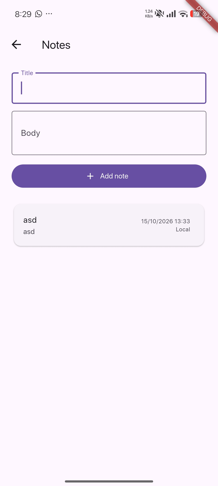
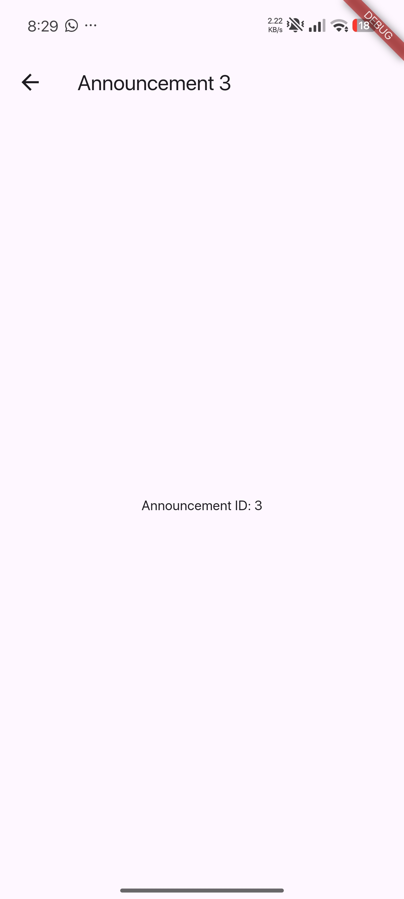
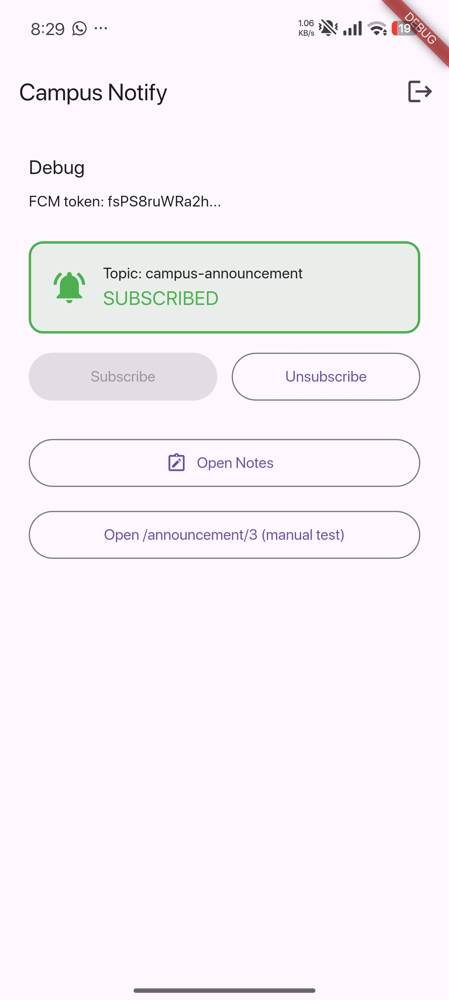

# Campus Notify — Mid-semester portfolio review

This portfolio continues the Week 5–7 Campus Notify project in `07-week-7-clean-architecture/campus_notify`; it is not a new app. The portfolio folder collects the review record, current status, run guide, and screenshots.

## Mid-semester status

On the source branch `feat/notes-validation`, blank and whitespace-only note titles are rejected by a shared domain validator. Valid titles are trimmed before saving. The UI shows validation feedback, and the widget tests cover empty input, whitespace-only input, and successful note creation.

The local machine checks passed on October 29, 2026:

| Check | Result |
|---|---|
| `flutter analyze` | Pass — no issues found |
| `dart format --set-exit-if-changed .` | Pass — 33 app files checked, 0 changed |
| `flutter test` | Pass — all 17 tests passed |

The feature branch has 244 changed lines relative to `develop`, so it remains below the 300-line review limit. It has not yet merged. Formal peer re-review/approval and GitHub check results are pending. A manual Notes test and validation-specific screenshot are also pending: only macOS was available, and its build stalled fetching Firebase Swift packages.

## Issue and PR map

| Issue | Pull request | Status |
|---|---|---|
| [#12 — reject blank note titles](https://github.com/emrizky1/244107020140-mobile-course/issues/12) | [#1 — validate blank titles and add a test](https://github.com/emrizky1/244107020140-mobile-course/pull/1) | Open, targeting `develop`; feedback addressed in code, awaiting peer approval and merge |

## Main features

- Authentication flow with secure token storage and route protection.
- Local Notes CRUD backed by SQLite and Riverpod.
- Blank-title validation with user feedback and a shared domain rule.
- Firebase Cloud Messaging and announcement routing.
- Feature-first structure with separate presentation, domain, and data responsibilities.

## Tech stack

Flutter and Dart, Riverpod, GoRouter, SQLite (`sqflite`), Dio, Firebase Core/Auth/Messaging, Flutter Secure Storage, and Flutter test.

## How to run

From the repository root:

```bash
cd 07-week-7-clean-architecture/campus_notify
flutter pub get
flutter run
```

Run the machine checks from the same app directory:

```bash
flutter analyze
dart format --set-exit-if-changed .
flutter test
```

Pull requests also run these checks through [the CI workflow](../.github/workflows/ci.yml).

## References

- [Flutter app architecture guide](https://docs.flutter.dev/app-architecture/guide)
- [Flutter testing overview](https://docs.flutter.dev/testing/overview)
- [Dart formatter](https://dart.dev/tools/dart-format)
- [Dart analyzer](https://dart.dev/tools/dart-analyze)

## PR description

**Problem:** Users can submit a note with an empty or whitespace-only title, or receive no useful feedback when the title is invalid.

**Solution:** Add a pure Notes-domain title validator, enforce it in the notifier, show the validation message in the page, and trim valid title/body input before saving.

**Test steps:**

1. From `07-week-7-clean-architecture/campus_notify`, run `flutter test test/notes_test.dart`.
2. Submit an empty title and a whitespace-only title; confirm each shows validation feedback and saves nothing.
3. Submit a padded valid title and body; confirm the saved values are trimmed and the fields clear.

**Screenshots:** Existing app captures are included below. They document the Notes, Announcements, and Auth screens; a fresh screenshot of the validation message is pending the manual run.







## Result achieved

Automated tests confirm that blank titles cannot be saved through the page or notifier, that validation feedback appears, and that valid padded input is trimmed. The source PR remains open until peer re-review and approval; no merge is claimed in this portfolio record.
