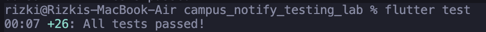
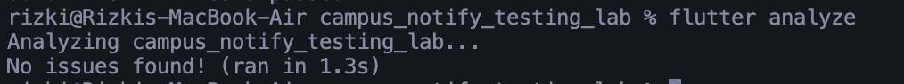
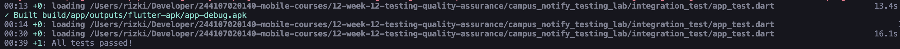

# Week 12: Testing and Quality Assurance
 
Feature under test: **Notes** (add a note, list notes, search by title) from Campus Notify.
The feature is split into a domain layer (`Note`, `NoteRepository`, use cases), a data layer
(`NoteModel`, `NoteRepositoryImpl` on sqflite) and a presentation layer (`NotesNotifier`, `NotesPage`).
 
## Behavior scenarios
 
| # | Type | Scenario | Expected behavior |
|---|------|----------|-------------------|
| 1 | Happy path | User enters a title and body and taps **Add note** | The note appears at the top of the list, is marked `Local`, and the form is cleared |
| 2 | Edge case | User taps **Add note** with an empty or whitespace-only title | Nothing is saved, the repository is never called, the list is unchanged |
| 3 | Edge case | User searches with different casing, extra spaces, or text that only appears in a note body | Only titles are matched, ignoring case and surrounding spaces; no match shows "Tidak ada judul catatan yang cocok." and clearing the search restores the list |
| 4 | Failure | Saving fails (database error) | An error message and a retry button are shown, the list is unchanged, and the typed text is kept |
| 5 | Failure | Loading fails (database cannot be opened) | The repository returns an empty list and a `LocalFailure`; a later successful load clears the error |
| 6 | State | A save is still in progress | The button is disabled and a spinner is shown until the repository answers |
| 7 | Main flow | Add a note, search for it, close and reopen the app | The note survives a restart because it was written to the database |
 
## Test map
 
| Lab step | File | Covers scenario |
|----------|------|-----------------|
| Test the logic | `test/notes_logic_test.dart` | 3, plus `NoteModel` mapping (null columns, corrupt date) |
| Test a dependency | `test/helpers/fake_note_repository.dart`, `test/notes_notifier_test.dart` | 1, 4, 5, 6 and `NoteRepositoryImpl` returning `LocalFailure` |
| Test the UI | `test/notes_page_test.dart` | 1, 2, 4, 6 and the initial/loading display |
| Test the main flow | `integration_test/app_test.dart` | 1, 3, 7 against a real in-memory sqflite database |
 
Small changes to production code, made only so the UI could be tested: stable `Key`s on the title,
body and search fields and the add button in `notes_page.dart`, and `integration_test` added to
`dev_dependencies`.
 
## Results (19 November 2026)
 
| Command | Result |
|---------|--------|
| `flutter test` | All 28 tests passed |
| `flutter test --coverage` | All 28 tests passed; coverage generated in `coverage/lcov.info` |
| `flutter test integration_test/app_test.dart -d 5PBE6DGQDYTCBULB` | Passed on a physical Android device (24095PCADG, Android 16) |
| `flutter analyze` | No issues found |

### Code coverage

Coverage was generated with `flutter test --coverage` (28 tests passed).

| File | Covered lines | Coverage |
|------|---------------|----------|
| `lib/core/failures.dart` | 2/5 | 40.0% |
| `lib/features/notes/data/repositories/note_repository_impl.dart` | 5/12 | 41.7% |
| `lib/core/format.dart` | 6/10 | 60.0% |
| `lib/features/notes/presentation/providers/notes_providers.dart` | 50/51 | 98.0% |
| `lib/features/notes/domain/entities/note.dart` | 1/1 | 100.0% |
| `lib/features/notes/data/models/note_model.dart` | 20/20 | 100.0% |
| `lib/features/notes/domain/usecases/add_note.dart` | 3/3 | 100.0% |
| `lib/features/notes/domain/usecases/fetch_notes.dart` | 3/3 | 100.0% |
| `lib/features/notes/domain/usecases/filter_notes.dart` | 8/8 | 100.0% |
| `lib/features/notes/presentation/pages/notes_page.dart` | 93/93 | 100.0% |

The remaining uncovered provider line is the intentional `StateError` guard in
`noteRepositoryProvider`, which requires the repository to be overridden in the app composition
root. The repository tests currently cover database-opening failures; successful database
query and insert paths are not yet covered.

### Evidence

 
### Blockers met while running the integration test
 
1. `flutter test integration_test/app_test.dart` found no supported device because the project had no
   `android/` or `macos/` folders. Fixed with
   `flutter create . --platforms=android,macos --project-name campus_notify` and by passing `-d <device_id>`.
2. The Android build failed because `flutter_local_notifications` requires core library desugaring.
   Fixed by enabling `isCoreLibraryDesugaringEnabled` and adding the `coreLibraryDesugaring` dependency
   in `android/app/build.gradle.kts`.
3. The phone rejected the install with `INSTALL_FAILED_USER_RESTRICTED`. Fixed by enabling
   "Install via USB" in the phone's developer options and accepting the install prompt.
### Unresolved findings
 
- The Android build prints a warning that `firebase_auth` and `firebase_core` apply the Kotlin Gradle
  Plugin, and that future Flutter versions may fail to build with such plugins. This is for the plugin
  authors to fix or for a dependency upgrade; it does not affect the tests.
- The integration test builds `NotesPage` directly with an in-memory database instead of starting the
  whole app through `main()`, because `main()` also initializes Firebase and asks for notification
  permission. Login, push notifications and the AI chat are therefore not covered by it.
- Code coverage was measured with `flutter test --coverage`. The Notes page, domain use cases, model mapping and entity have full coverage. The repository and core utility files still have untested lines.
## Reflection
 
**Which bug would have been easiest to miss without the tests you wrote?**
The one in the save-failure path. The page only clears the title and body when the save succeeded, so
a failure that also cleared the text would still look fine when clicking through the app with a working
database. Nobody sees it unless the database actually fails, and the fake repository with
`addFailure` lets a widget test check both that the error appears and that the typed text is kept.
A second easy-to-miss case is a new note that does not match the active search: it is stored but
must stay hidden from the visible list.
 
**Where did you need a fake, and how did it make the test more consistent?**
`FakeNoteRepository` replaces the sqflite-backed repository in the notifier and widget tests. It makes
success and failure available on demand, and its `Completer` gates hold a call open, so the loading
and saving states can be observed instead of racing past. It also removes the need for a real database
or a device, so those tests run in a few seconds and give the same result every time.
 
**What did the widget and integration tests each tell you about your feature?**
The widget tests showed that the page reacts correctly to each state it is given: empty list, loading,
blank input, success, error, and a disabled button while saving. They cannot say whether the data really
reaches storage. The integration test showed that the whole chain (page, notifier, use cases, repository,
sqflite) works together and that a saved note is still there after the app is recreated. It also exposed
problems the other tests could never see, such as the Android build configuration and device install
restrictions.